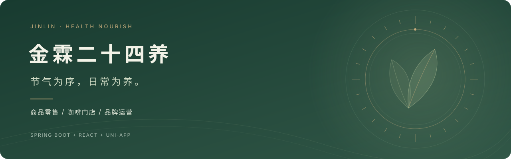
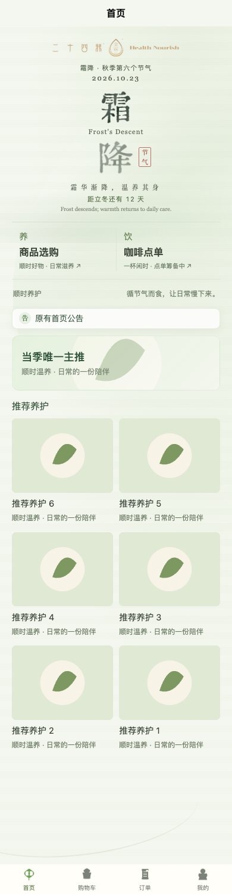
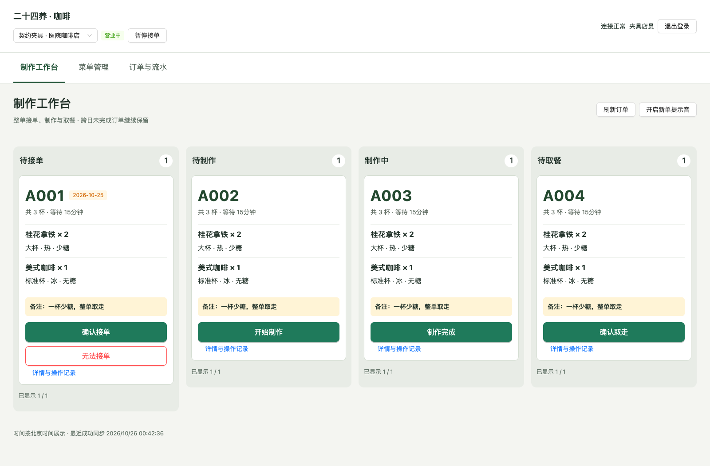
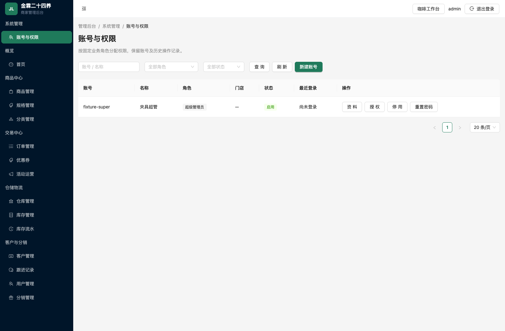
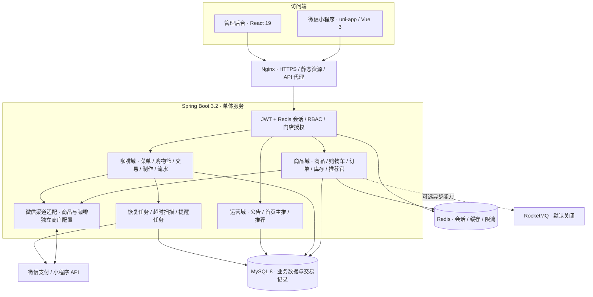

<p align="center">
  
</p>

<h1 align="center">金霖二十四养</h1>
<p align="center"><strong>品牌私域商城 × 咖啡门店运营 · 三端一体的全栈实践</strong></p>
<p align="center">Spring Boot 后端 · React 管理端 · uni-app 微信小程序</p>

<p align="center">
  
  
  
  
  
  <a href="https://github.com/boyforest/jinlin24th-mall-project/stargazers"></a>
</p>

<p align="center">
  <a href="#界面预览">界面预览</a> ·
  <a href="#功能版图">功能版图</a> ·
  <a href="#系统架构">系统架构</a> ·
  <a href="#本地运行">本地运行</a> ·
  <a href="#文档导航">文档导航</a>
</p>

## 关于这个项目

这是一个软件工程学生从零开始、随着真实业务需求持续迭代的全栈项目。最初是一套品牌私域商城，如今逐步扩展为同时服务**商品零售与咖啡门店**的业务系统。

小程序以二十四节气组织品牌表达，将草木绿、纵向墨字与轻动效融入购物体验；管理端则按角色区分商品运营与咖啡制作，让不同岗位进入适合自己的工作界面。三端代码、数据库迁移和实施文档集中在同一个 Monorepo 中维护。

**适合关注这些方向的朋友：** Java 全栈实战、微信小程序、新中式界面设计、RBAC 权限、支付退款，以及从单一商城演进到双业务的架构设计。

## 界面预览

<table>
  <tr>
    <td width="28%" valign="top">
      <strong>节气品牌首页</strong><br />
      <sub>纵向墨字 · 双业务入口 · 运营推荐</sub><br /><br />
      
    </td>
    <td width="72%" valign="top">
      <strong>咖啡制作工作台</strong><br />
      <sub>人工接单 · 四列状态看板 · 制作与取餐</sub><br /><br />
      <br /><br />
      <strong>账号与权限</strong><br />
      <sub>超管维护账号 · 业务角色分权 · 门店授权</sub><br /><br />
      
    </td>
  </tr>
</table>

<sub>以上为当前代码的本地回归截图，使用示例数据和占位素材。更多真实服务联调截图与验证边界见[最终验收记录](docs/next-version/acceptance-final-20261026.md)。</sub>

## 值得一看的实现

| 方向 | 具体做法 |
| --- | --- |
| **有品牌感的小程序** | 二十四节气展示、墨字肌理、本地打包的字形资源、节气倒计时；保留内容可读性，让动效服务品牌表达 |
| **商品与咖啡各自成体系** | 共用品牌首页与用户身份，分别维护菜单/商品、购物车与交易数据；订单入口按业务分类汇总 |
| **岗位决定工作界面** | 商品管理员使用常规运营后台，咖啡管理员进入制作工作台；服务端同时检查模块权限与门店范围 |
| **面向店员的操作流程** | 人工确认接单与开始制作分开，规格和备注直接可见；状态冲突后刷新最新订单，避免重复处理 |
| **交易状态有依据** | 服务端报价、订单快照、稳定支付/退款单号、回调验签与金额核对；咖啡交易保留事件和恢复任务 |
| **小规模也能运营** | 复用现有广告数据与接口，实现首页单张主推、最多六项推荐、有效期与排序；推荐官佣金采用线下结算 |

## 功能版图

| 业务 | 当前代码包含 |
| --- | --- |
| 品牌与运营 | 节气首页、商品/咖啡双入口、公告与弹窗、首页主推与推荐养护 |
| 商品商城 | 分类、商品与 SKU、固定购买栏、独立购物车、服务端订单核对、订单列表与详情、微信支付接口 |
| 用户与推荐官 | 微信登录、会员与积分、邀请绑定、推荐官快照、佣金记录、退款回退、CSV 导出与线下结算登记 |
| 商品运营后台 | 商品、规格、分类、订单、优惠券、用户、客户跟进、仓储与库存、分销管理 |
| 咖啡目录 | 门店、分类、饮品与规格、可售状态、独立购物篮与版本冲突处理 |
| 咖啡工作台 | 人工接单/拒单、待制作/制作中/待取餐、整单取餐、全额退款、订单事件、订单与流水查询 |
| 账号与分权 | 三种固定角色、账号启停、授权与门店绑定、重置密码、首次改密、旧会话撤销与操作审计 |
| 提醒服务 | 制作完成事件与持久化订阅消息任务、发送状态记录、失败与不确定结果区分 |

> **当前交付边界：** 咖啡后端与工作台已完成上一轮代码验收。顾客结算、支付调用和取餐详情已实现，[本轮本地验证](docs/next-version/coffee-checkout-verification.md)已记录；原生、真机与真实商户验收尚未完成。订阅授权另行接入，咖啡下单/支付开关默认关闭。

### 三种角色，两类工作界面

| 角色 | 工作范围 | 默认界面 |
| --- | --- | --- |
| 超级管理员 `SUPER_ADMIN` | 全局业务、账号与授权、公共首页运营 | 管理后台，可进入咖啡工作台 |
| 商品管理员 `GOODS_ADMIN` | 商品业务及对应运营模块 | 商品运营后台 |
| 咖啡管理员 `COFFEE_ADMIN` | 获授权门店的菜单、制作、订单与流水 | 咖啡工作台 |

前端按服务端权限上下文显示菜单与路由；后端独立校验请求。隐藏菜单之外，直接请求无权接口同样受到约束。

## 系统架构

项目采用 **Monorepo + Spring Boot 单体后端 + 按业务分开的前端与数据模型**。商品和咖啡复用基础设施，咖啡订单、支付与退款独立建模，沿用现有底座扩展门店业务。



### 关键技术方案

- **双业务隔离：** 商品与咖啡分别使用 API、购物车状态和交易记录；统一订单查询按业务类型呈现。咖啡保留 `COFFEE_PAY_*` 配置空间，首版通过显式配置与商品共用商户凭据，回调和业务记录继续分开。
- **服务端定价与并发：** 商品确认订单先请求只读报价，正式提交重新检查金额与库存；咖啡操作携带版本号和请求键，冲突时回读服务端状态。
- **支付与退款：** 保存稳定渠道单号，校验通知签名及交易事实。咖啡先持久化退款意图再请求渠道，申请受理与退款成功分开记录，状态不确定时按原单号查询。
- **咖啡履约：** 付款确认 → 待接单 → 待制作 → 制作中 → 待取餐 → 已取餐。整单制作、整单取餐、整单全额退款；不自动接单。
- **持久化恢复：** 咖啡定时任务扫描未付款单、待查询支付、退款和提醒；进程重启后继续处理。提醒失败不回滚制作完成，发送结果不确定时不盲目重发。
- **可选消息队列：** RocketMQ 提供商品订单超时、操作日志等异步路径；默认不启用，商品订单保留定时超时取消兜底。短信消费者目前为模拟日志。

### 技术栈

| 层次 | 选型 |
| --- | --- |
| 后端 | Java 17 · Spring Boot 3.2.5 · MyBatis-Plus 3.5.5 · Maven Wrapper |
| 数据与会话 | MySQL 8 · Redis · JWT · BCrypt |
| 管理端 | React 19 · Vite 7 · React Router 7 · Ant Design 6 · Axios |
| 小程序 | uni-app · Vue 3 · TypeScript · Pinia · Vite 5 |
| 微信接入 | WxJava MiniApp SDK · 微信支付 API v3 |
| 可选异步 | RocketMQ Spring Boot Starter |
| 部署 | Docker Compose · Nginx · 环境变量配置 |
| 验证 | JUnit / Spring Boot Test · MySQL 集成测试 · Node Test Runner · Playwright |

## 项目结构

```text
.
├── src/main/java/com/jinlin24th/jinlin/
│   ├── common/             # 鉴权、权限、配置、缓存、错误码等
│   ├── controller/         # 小程序、管理端与渠道回调入口
│   ├── service/            # 商品、咖啡、运营与交易服务
│   ├── mapper/             # MyBatis-Plus 数据访问
│   ├── pojo/               # Entity / DTO / VO
│   └── task/               # 订单超时与咖啡恢复任务
├── src/test/               # 后端单元与集成测试
├── admin-web/              # React 商品后台与咖啡工作台
├── c-uniapp/               # uni-app 小程序与 H5 验证入口
├── sql/                    # 新安装结构、增量迁移、可选演示数据
├── deploy/                 # Nginx 与 MySQL 初始化配置
├── scripts/                # 开发、备份、MQ 与专项验证脚本
├── docs/                   # 方案、契约、实施与验收记录
└── docker-compose.yml      # MySQL / Redis / 后端 / 管理端 / Nginx
```

## 本地运行

准备 **JDK 17、Node.js 22.18+、MySQL 8、Redis** 和微信开发者工具。Maven 由仓库 Wrapper 提供；基础开发不需要启动 RocketMQ。

### 1. 拉取与配置

```bash
git clone https://github.com/boyforest/jinlin24th-mall-project.git
cd jinlin24th-mall-project

# 仅用于新建数据库；已有数据请按部署文档执行增量迁移
mysql -uroot -p < sql/jinlin24th_init.sql

cp src/main/resources/application-dev.example.yml src/main/resources/application-dev.yml
```

填写本地 MySQL、Redis 连接和至少32字节的 JWT 密钥；真实微信登录还需使用自己的 AppID / Secret。`application-dev.yml` 不提交到仓库，管理账号以数据库为准。

### 2. 启动后端

```bash
./mvnw spring-boot:run
```

默认地址 `http://localhost:7878`；dev 配置开启的接口文档位于 `http://localhost:7878/swagger-ui/index.html`。

新安装的初始账号为 `admin` / `123123`，首次登录须修改密码。旧库升级保留原账号和密码，不会自动重置为该初始值。

### 3. 启动管理端

在新终端中执行：

```bash
cd admin-web
npm ci
npm run dev
```

访问 `http://localhost:5173`，开发代理默认将 `/admin` 转发至后端；可用 `VITE_API_TARGET` 覆盖后端地址。

### 4. 启动微信小程序

在另一个终端中执行，先将 `c-uniapp/src/manifest.json` 与开发者工具项目配置中的 AppID 改为自己的：

```bash
cd c-uniapp
npm ci
VITE_API_BASE_URL=http://127.0.0.1:7878 npm run dev:mp-weixin
```

微信开发者工具导入 **`c-uniapp/dist/dev/mp-weixin/`**。真机联调请将 API 地址换成手机能访问的局域网地址或已配置的 HTTPS 域名。

正式构建需要 HTTPS API 地址：

```bash
VITE_API_BASE_URL=https://your-api-domain.example.com npm run build:mp-weixin
```

此时导入 **`c-uniapp/dist/build/mp-weixin/`**。dev 与 build 是不同目录，切勿在修改源码后仍编译另一份旧产物。历史 WXSS 和开发者工具问题见[小程序回归必查项](docs/next-version/miniprogram-regression.md)。

<details>
<summary><strong>开发脚本与 Docker 部署</strong></summary>

配置与依赖就绪后，可在根目录使用开发脚本：

```bash
./scripts/dev-up.sh
./scripts/dev-status.sh
./scripts/dev-down.sh
```

Docker Compose 包含 MySQL、Redis、后端、管理端与 HTTPS Nginx。部署前复制并填写 `.env.example`，同时按自己的域名和证书调整 `deploy/nginx/nginx.conf`；当前 Nginx 配置使用本项目域名与证书路径，不能原样当作通用本地演示环境。

生产数据库密码从 `DB_PASSWORD` 环境变量读取；Compose 将 `MYSQL_APP_PASSWORD` 映射为后端的 `DB_PASSWORD`。MySQL、Redis、JWT、CORS 和微信配置以 [.env.example](.env.example) 为准。存量升级前先备份，按[咖啡工作台部署交接](docs/next-version/backend-deployment.md)执行增量迁移，不对已有库重跑初始化文件。

</details>

## 测试与验收

2026-10-26 的[最终代码验收](docs/next-version/acceptance-final-20261026.md)记录：

| 层次 | 结果 |
| --- | --- |
| 后端测试 | 269项通过 |
| MySQL 专项 | 71项通过，覆盖存量迁移、重复执行及新安装 |
| 实际 prod JAR 的 HTTP 检查 | 31项通过 |
| 管理端单元测试 | 36项通过 |
| 浏览器交互回归 | 工作台20 / 首页运营12 / 双业务27 / 原购物18个场景通过 |
| 构建与类型检查 | 管理端构建、小程序类型检查、H5 与 mp-weixin 构建通过 |

上述结果为该次验收快照；浏览器回归含契约夹具，原生、真机、真实支付和订阅授权另行验收。

在根目录执行常用检查：

```bash
./mvnw test
npm --prefix admin-web test
npm --prefix admin-web run build
npm --prefix c-uniapp run type-check
npm --prefix c-uniapp run test:solar-terms
```

需要 Docker、Python 3 和 `rg` 的隔离 MySQL / HTTP 验证：

```bash
./mvnw -DskipTests clean package
COFFEE_HTTP_JAR=target/jinlin24th-1.0.0.jar bash scripts/test-coffee-mysql.sh
```

脚本创建并清理专用测试容器，不读取应用的原数据库配置。Playwright 场景的启动端口、依赖与环境变量见[前端验证记录](docs/next-version/frontend-verification.md)。

## 文档导航

| 想了解什么 | 从这里开始 |
| --- | --- |
| 双业务如何拆分与兼容 | [双业务方案与接口契约](docs/dual-business/README.md) |
| 分权、工作台和运营的产品取舍 | [产品讨论稿](docs/next-version/coffee-workbench-rbac-discussion.md) |
| 前后端如何协作实现 | [实施文档入口](docs/next-version/README.md) · [共用契约](docs/next-version/implementation-contract.md) |
| 咖啡单商户收款与开放步骤 | [单商户接入交接](docs/next-version/coffee-shared-merchant.md) |
| 数据迁移、配置与恢复 | [后端部署交接](docs/next-version/backend-deployment.md) |
| 本轮究竟验证了什么 | [最终验收记录](docs/next-version/acceptance-final-20261026.md) |
| 小程序编译、WXSS 与旧包排查 | [历史问题与回归清单](docs/next-version/miniprogram-regression.md) |
| 推荐官与佣金如何运营 | [管理端操作说明](docs/admin-operation-guide.md) |

## 接下来的方向

- [x] 顾客侧咖啡结算、微信支付调用与取餐订单详情。
- [ ] 完成咖啡真实商户交易及 iOS / Android 验收后开放线上收款。
- [ ] 接通取餐订阅授权，验证模板、消息发送与订单展示的完整体验。
- [ ] 持续优化门店工作台、异常订单处理和首页内容运营。
- [ ] 美团 / 抖音团购券核销，待商家接入条件确认后推进。
- [ ] 品牌虚拟形象 AI 助手，作为后续独立探索。

## 交流与参与

欢迎通过 [Issues](https://github.com/boyforest/jinlin24th-mall-project/issues) 提交问题、分享使用体验或讨论改进，也欢迎围绕具体问题提交 PR。复现问题时附上运行环境、操作步骤和日志，会更容易定位。

项目尚未指定统一开源许可证；品牌素材及随附字体按各自权利与许可使用，复用前请确认授权范围。

如果这个项目的视觉、业务设计或全栈实践对你有帮助，欢迎点一颗 **Star**，陪它继续长大。🌿
